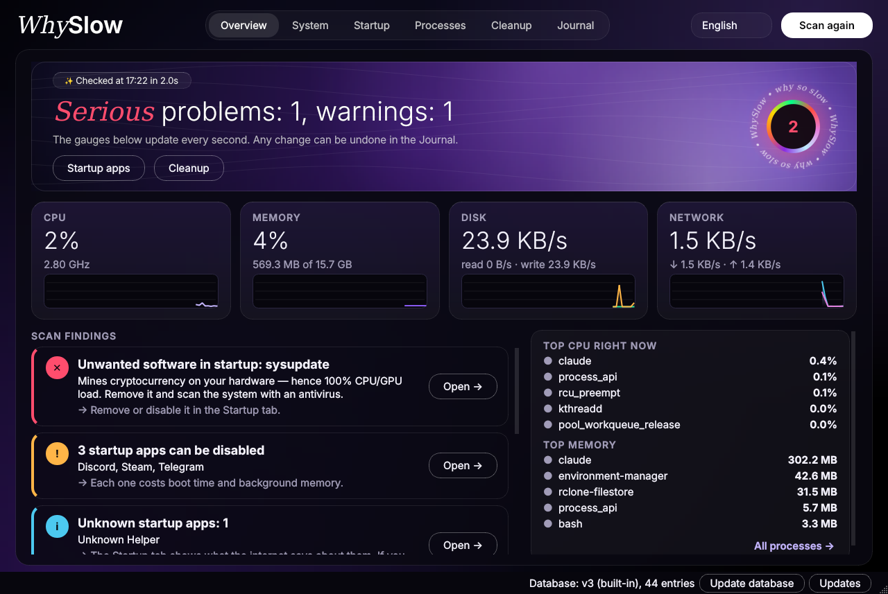
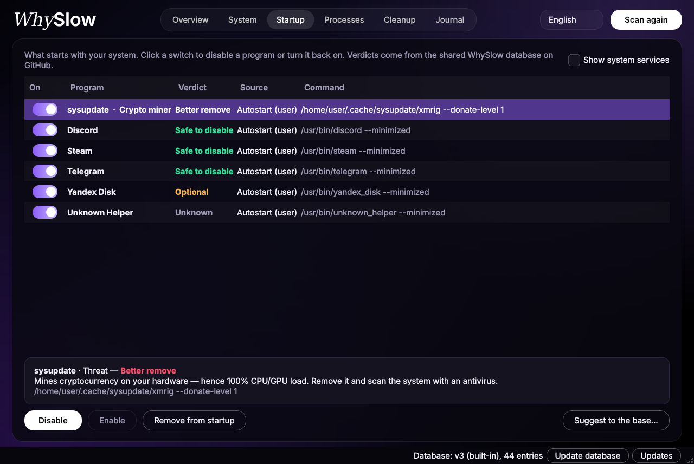

<div align="center">

# 🐢 WhySlow

**Explains why your computer is slow and helps fix it** — in plain language, without ad-ridden "optimizers".

[🇷🇺 Русский](README.ru.md) · 🇬🇧 English · [⬆ Home](README.md)

</div>

One utility in the spirit of CPU-Z / GPU-Z: hardware info, load, startup items, junk files, processes.
What sets it apart is a **shared knowledge base on GitHub**: WhySlow checks every startup item and every
process against it and tells you whether it is safe to disable, better left alone, or worth removing.



## Contents

* [What it does](#what-it-does)
  * [Tabs](#tabs)
  * [One-click optimization](#one-click-optimization)
  * [macOS System Data](#macos-system-data)
  * [Reinstalling the system](#reinstalling-the-system)
  * [Moving to a new PC](#moving-to-a-new-pc)
  * [Hidden pests](#hidden-pests)
  * [Leaked passwords](#leaked-passwords)
  * [Outlook: how long the hardware will last](#outlook-how-long-the-hardware-will-last)

  * [Freeze X-ray and game mode](#freeze-x-ray-and-game-mode)

  * [PC twin and risk cost (subscription)](#pc-twin-and-risk-cost-subscription)
  * [Problems it finds](#problems-it-finds)
  * [Safety](#safety)
  * [Platform support](#platform-support)
* [Subscription](#subscription)
* [Install and run](#install-and-run)
  * [Download](#download)
  * [Windows](#windows)
  * [macOS](#macos)
  * [Linux](#linux)
  * [From source](#from-source)
  * [Text mode](#text-mode)
  * [Language](#language)
* [Updates](#updates)
  * [Publishing a new version](#publishing-a-new-version)
* [Temperature sensors](#temperature-sensors)
* [Knowledge base](#knowledge-base)
  * [Entry format](#entry-format)
  * [When a program is not in the base](#when-a-program-is-not-in-the-base)
  * [Suggesting an entry](#suggesting-an-entry)
  * [Hardware requirements](#hardware-requirements)
* [How it is built](#how-it-is-built)

## What it does

### Tabs

| Tab | What it does |
|---|---|
| **Overview** | Live CPU, memory, disk and network tiles with charts, what is loading the system right now, and a single **Check** button that lists problems with explanations and a **Fix** button |
| **Optimize** | A single **Optimize** button: WhySlow builds a fix plan on its own and applies the checked items after **Apply** |
| **System** | CPU with every core separately, clock speeds, memory, integrated GPU load, disks, network, temperatures — last-minute charts with a scale and hover tooltips |
| **Outlook** | Roughly how many more years the hardware will handle browsing, work, games and video editing, what runs out first, and what to upgrade when |
| **Twin** | Subscription. What a new graphics card, memory, SSD or CPU would do for this exact computer: game frame rates, memory load, how many more years the hardware lasts |
| **Risk cost** | Subscription. What might break (disks, battery, overheating), how likely it is, and what dealing with it now costs versus later |
| **Startup** | Everything that starts with the system, plus the knowledge base verdict. Toggle items on or off right in the list, or remove them |
| **Processes** | Programs grouped by name (a browser is dozens of processes), with the knowledge base verdict. If a program starts with the system, you can remove it from startup right here |
| **Cleanup** | Temporary files, caches, recycle bin. Only removes your own files older than one day. Finds large files in a chosen folder and moves them to the Trash |
| **Storage** (macOS only) | What “System Data” is made of: categories with sizes, each marked important, safe to delete, or removed automatically; deleting to the Trash and auto-clean |
| **Reinstall** | Reinstall the system with one button: the chosen folders are copied to another disk first, then the Windows or macOS reinstall window opens |
| **Move** | Move to a new PC with one button: programs, their settings and your files, without junk (subscription) |
| **Pests** (subscription) | Hidden miners, browser extensions that see every site, programs that go online at night, and a connection map |
| **Passwords** | Checks passwords from your password manager against breach databases and replaces leaked ones with new random ones |
| **Compare** | Subscription: anonymously compares your PC with computers on the same hardware (boot time, idle load, startup) and names the programs fast similar PCs don't have |

| **X-ray** ⭐ | Press Ctrl+Alt+X the moment things freeze and WhySlow breaks down the last 20 seconds: which app, driver, disk, network or overheating ate that second |
| **Games** ⭐ | Game mode: notices a game starting, with your consent gives it the CPU and power, restores everything afterwards and shows what it gave you |
| **History** | When and why the computer was slow: WhySlow records long load spikes in the background, can live in the tray and start with the system |
| **Journal** | Everything WhySlow changed. Any startup or proxy change can be rolled back with one click |

### One-click optimization

The **Optimize** button (on the Optimize tab and on the Overview) checks the computer and picks what to fix on its own:

* turn off a stuck proxy that broke the internet;
* disable startup items the knowledge base marks as unneeded or unwanted;
* close heavy background programs the knowledge base knows about;
* clean temporary files, caches and the recycle bin.

The plan is shown as a checklist. Safe items are pre-checked; questionable ones (services, items that need
administrator rights, the recycle bin, closing programs) you check yourself; anything the knowledge base says to keep
is never offered. Nothing changes until you press **Apply** and confirm. Startup and proxy changes can be rolled back
in the Journal; cleanup and closing programs are permanent, and the list says so. Things the program can't fix on its own
(no reboot for a long time, overheating) are shown below as advice.

### macOS System Data

In Mac storage settings, “System Data” is a single grey bar you can't open. The **Storage** tab splits it into
categories, sorted by size:

| Category | Label |
|---|---|
| App caches (`~/Library/Caches`), app logs, simulator caches, Xcode DerivedData | safe to delete |
| “Install macOS…” installers, Xcode device support, Mail attachments, Trash | safe to delete |
| iPhone and iPad backups, Xcode archives, simulators, Docker | important, keep |
| App data (Application Support, Containers, Group Containers) | depends, per app |
| Local Time Machine snapshots, system caches and logs, downloaded macOS updates, swap | removed automatically |

Each category explains what it is and what deleting it means, and lists its folders with size and date
(iPhone backups show the device name and backup date). Checked items are only deleted after you confirm:

* files are **moved to the Trash**, and every deletion goes to the Journal, where it can be put back;
* for important categories the confirmation lists exactly what will go and asks you to double-check;
* Time Machine snapshots are deleted with `tmutil`; macOS asks for an administrator password;
* WhySlow doesn't delete Docker data or simulators itself; it tells you where to do it properly.

**App data** is split by app: one row per app, with its size and when you last opened it. WhySlow matches the
folders against installed apps and labels them:

* **removed app leftovers**: the app is gone but its data stayed, safe to delete;
* **unused for N months**: you haven't opened the app for over half a year (say, a game you stopped playing);
  delete its data, and on a separate row the app itself;
* **in use** and **apps by the same developer**: can be deleted, but the app loses its settings and sign-in;
* **app not found**: couldn't tell whose folder it is, check yourself;
* **system**: macOS data, can't be deleted.

Along with an app's folders, its settings (`Preferences`), saved windows and cookies go to the Trash.

**Auto-clean** is a switch at the bottom of the tab, off by default. When on, WhySlow deletes files older than 7 days
from the safe categories (app caches and logs, Xcode DerivedData, simulator caches) every day, week or month, your choice.
It runs while WhySlow is open; every run shows on the tab and in the Journal.

**Full Disk Access.** Without it macOS hides iPhone backups, Mail, the Trash and some app data. WhySlow notices and
shows how to grant it: System Settings → Privacy & Security → Full Disk Access → turn on WhySlow (or Terminal if you
run from source) and restart the app. The **Open Settings** button opens that page directly.

### Reinstalling the system

The **Reinstall** tab reinstalls the system with one button. WhySlow itself erases nothing: it starts the operating
system's own mechanism, and that window asks for confirmation once more.

1. Pick a mode: **Keep files** or **Erase everything**.
2. Tick what to keep: Desktop, Documents, Downloads, Pictures, Music, Videos or any folder of your own
   (“Add folder…”). Each folder's size is measured right away.
3. Choose where the backup goes: another internal disk, an external disk or a USB drive. The system disk can't be
   chosen, since the backup would be wiped along with it. There must be enough free space.
4. Press “Reinstall the system” and confirm by ticking “I understand…”. WhySlow copies the folders and opens the OS window.

| System | What opens |
|---|---|
| Windows | “Reset this PC”. Choose “Remove everything” for a clean Windows; the chosen folders come back from the backup. “Keep my files” keeps all your personal files. Don't turn on “Remove files from all drives” if the backup is on another internal drive |
| macOS, keep files | The macOS installer of the same version (if missing, WhySlow downloads it with `softwareupdate`, several gigabytes). macOS is installed on top: files, apps and settings stay; the backup is just in case |
| macOS, erase everything | “Erase All Content and Settings” (macOS 12 or later on Apple Silicon or with a T2 chip). If it isn't available, WhySlow explains how to do it from Recovery |
| Linux | Backup only: there's no common way to reinstall, use your distribution's installer |

The backup folder has `restore.bat` (Windows) or `restore.command` (macOS), which put the files back even without
WhySlow. Or install WhySlow again and press “Restore from backup…”. Existing files are never overwritten on restore.
Files that couldn't be copied (no access, in use) are listed in `whyslow-backup.json`, and WhySlow asks whether to go
on with the reinstall without them. Programs and browser passwords aren't part of the backup: install the programs
again, and turn on sync in your browser, or use the **Move** tab below, which takes programs and settings too.

### Moving to a new PC

The **Move** tab (subscription) moves your setup to a new computer with one button, without the junk that has piled
up over the years.

1. **On the old PC** pick “This is the old PC: pack”. WhySlow lists installed programs and how each one installs
   again (winget on Windows; Homebrew and the App Store on macOS; Flatpak on Linux; VS Code extensions everywhere),
   finds settings of known apps (VS Code, Git, Chrome / Yandex Browser / Edge bookmarks, OBS, Notepad++, Windows
   Terminal, PowerShell, zsh / bash, iTerm2, fonts; SSH keys only if you tick them) and your folders.
2. Untick what you don't need and choose a USB, external or network drive. Caches, temporary files, `node_modules`,
   `Thumbs.db` and old installers in Downloads are left out. Nothing changes on the old computer.
3. **On the new PC** pick “This is the new PC: unpack” → “Open package…” and choose the `WhySlow-Move-…` folder.
   Ticked programs install themselves, settings go in place (the ones already there are backed up and can be
   restored from **Journal**), files go back to their folders without overwriting existing ones.

The package works without WhySlow too: `install.bat` / `install.command` installs the programs, `files/restore.bat` /
`restore.command` brings back the files, and `programs.txt` lists what to download by hand. Settings move between
Windows and macOS where the app keeps the same files (VS Code, Git, bookmarks, OBS).

### Hidden pests

The Pests tab looks for what doesn't catch the eye. It is part of the subscription.

* **Hidden miners.** A mining-pool address or algorithm on the command line, a connection to a pool port, CPU or GPU
  load while nobody is at the computer, a file in a folder normal programs don't run from. Per-process GPU load comes
  from the same counters Task Manager uses, and from `nvidia-smi`.
* **Browser extensions** in Chrome, Edge, Brave, Yandex Browser, Opera, Vivaldi, Firefox and Safari. For each one you
  see whether it can read every site and what else it can do (intercept requests, read cookies and history, set its
  own proxy), and whether it came from the store, from another program, or was forced in through a browser policy.
* **Online at night.** While WhySlow is open or in the tray, it notes every 5 minutes which programs hold internet
  connections. Between midnight and 6 am this only counts if nobody is at the computer. Sync and updates are marked
  as normal, unknown programs as suspicious.
* **Connection map.** The computer in the middle, programs around it, and the addresses they connect to on the
  outside. Red looks like a miner, yellow went online at night.

WhySlow explains every finding from the knowledge base. Closing a program, removing it from startup, moving its file
to quarantine or removing a forced extension install only happens after you confirm. Quarantine and removed policies
can be restored in the Journal tab. Extensions are removed in the browser itself: WhySlow opens their page.

### Leaked passwords

The **Passwords** tab finds passwords that already appear in data breaches and helps replace them.

1. Export your passwords to CSV: Chrome and Edge (Settings → Passwords → Export), Firefox (about:logins → ⋯ → Export),
   Safari and macOS Passwords (File → Export), Bitwarden, 1Password, KeePass, LastPass.
2. Open the file in WhySlow. Each password is checked against [Have I Been Pwned](https://haveibeenpwned.com/Passwords).
   Passwords never leave your computer: only the first 5 characters of the SHA-1 hash are sent, matching happens locally.
3. For a leaked password WhySlow suggests a new random one (20 characters, symbols optional) and opens the site's
   password change page. Change it there and press “I changed it on the site”.
4. “Save file for import” writes a file in the same manager's format with only the new passwords. Import it back into
   the manager and the old passwords are replaced.
5. “Delete password files” overwrites and deletes the export and the import file: they hold passwords in plain text.

The manager is updated only after the site is. Changing a password only in the manager would leave you with a
password the site doesn't accept.

### Outlook: how long the hardware will last

The Outlook tab detects the CPU, graphics, amount of memory and the system disk type, and compares them with what
operating systems, browsers, games and work apps require today and how fast those requirements grow.

* For each task (browser and office, work, online games, new demanding games, video editing and 3D) — roughly how many
  more years the hardware will handle it and what runs out first.
* Pick what you mostly do and WhySlow tells you what to upgrade and when: an SSD instead of a hard drive, memory,
  a graphics card, or the whole computer. It doesn't suggest replacing parts that can't be replaced in laptops and Macs.
* Separately — how much longer the OS will get updates on this hardware (Windows 10, Intel Macs and so on).

This is a rough estimate based on typical requirements, not a guarantee. The requirements live in
[`whyslow/data/hardware.json`](whyslow/data/hardware.json) and are updated from the internet just like the knowledge base.

### Comparison with similar PCs

When you press Compare, WhySlow builds an anonymous snapshot and **shows it to you in full first**: it is sent only after you tick the consent box. The snapshot holds the CPU and GPU model, memory size, disk type, OS version, boot time, idle load, and the number of processes and startup programs. Programs are sent only as entries of the open knowledge base, others only as a count. No name, computer name, paths, IP or subscription key is stored next to the snapshot on the server.

The server replies only with a summary (medians and program shares), and only if there are at least five similar PCs. «Delete my data from the server» erases the snapshot and withdraws consent.

### Freeze X-ray and game mode

⭐ — WhySlow Premium features: they're built into the app and unlock with a key.

**Freeze X-ray.** WhySlow always keeps the last minute of samples in memory: CPU and each core, memory, disk,
network, GPU, temperatures and the heaviest processes. When something freezes, press **Ctrl+Alt+X** (on Windows it
works even over a game) or pick “Take a freeze X-ray” from the WhySlow tray icon. It saves the last 20 seconds, takes a
one-second look at what's too costly to watch all the time (CPU time spent on driver interrupts, who is reading and
writing the disk right now) and lists the suspects in order: an app, a single maxed-out core, low memory, the disk, the
network, a driver, overheating or the GPU. If the whole system froze so hard that even the background sample was late,
a snapshot is taken automatically. Nothing in the system is changed.

**Game mode.** WhySlow recognizes a game by Steam, Epic, GOG and other store folders, by a list of known games, or by
games you add yourself. The Games tab then shows a checklist:

* lower the priority of heavy background apps (except what the database says to keep, system processes and what people
  use while playing: Discord, OBS, overlays). On macOS and Linux only an administrator can raise a priority back,
  so without those rights only pausing is offered there;
* pause unneeded ones while you play (only if you tick it);
* raise the game's own priority;
* switch to the High performance power plan (Windows) or the performance profile (Linux).

Nothing changes until you press “Turn on”. Tick “Turn on for this game without asking” and the plan applies by itself
next time. When the game closes, priorities, paused apps and power come back as they were, even if WhySlow was closed
or crashed mid-game. Afterwards you see how much CPU was freed for the game and, with the free
[PresentMon](https://github.com/GameTechDev/PresentMon/releases) next to it, the FPS before and after.

### PC twin and risk cost (subscription)

**Twin.** Before buying a part, see what it would do for this exact computer. WhySlow takes your hardware, how much
memory is in use right now and by whom, and how often the system ran out of CPU or memory over the past month
(History tab), and swaps in the new part:

* game frame rates before and after, and what limits them — graphics, CPU or video memory. Enter the FPS you
  actually see and the estimate adjusts to your settings;
* "14 of 16 GB in use right now, mostly Chrome; with 32 GB it would be 44%";
* how many more years the hardware lasts for your task, and what remains the weak spot;
* a rough price and a "best value" mark — the most benefit per dollar.

**Risk cost.** Disks (SMART), battery, overheating, and whether there's a backup (Time Machine, OneDrive, File
History). For each — the chance of trouble within a year, when to expect it, what dealing with it now costs, and
what it costs if you wait: "backup — $0, data recovery after a failure — $300–1,500".

Prices, part speeds and failure rates live in the same `hardware.json` and are updated from the internet. These are
estimates, not measurements or guarantees.

### Problems it finds

Each check answers its own question and offers a fix where possible:

* **No internet after a program was closed.** Some programs turn on a system proxy while running and leave it
  on if they crash. Nothing is listening on that proxy anymore, so the browser and other apps cannot go online.
  WhySlow detects this and turns the proxy off with one click (and can roll it back).
* **High CPU load.** Shows which program is causing it and what the knowledge base says about it.
* **Not enough memory.** Top processes by memory and how full the page file is.
* **Low disk space.** Especially on the system drive, plus how much cleanup can free.
* **Overheating.** Component temperatures above normal.
* **Clutter in startup.** What can be disabled, what is better removed, and for items not in the base, what the internet says about them.
* **Programs getting in each other's way.** Two antiviruses at once, several programs that reroute traffic,
  a network adapter or DNS left behind by a closed program, too many game overlays.
* **Slow or failing disk.** The system on a hard drive (HDD), the disk itself reporting a fault (SMART),
  the disk busy nearly all the time — with the programs reading and writing the most.
* **Power saving mode.** Battery saver throttles the CPU; plus battery wear.
* **No reboot for a long time.** A reminder that a restart often helps on its own.

### Safety

* A check **changes nothing**. Every action happens only after you confirm it.
* Startup items are disabled the same way the system's own tools do it:
  * **Windows** — via the `StartupApproved` flag (like Task Manager); Task Scheduler tasks are disabled
    as in Task Scheduler itself; services are set to Manual (Windows will start them if needed);
  * **Linux** — a copy of the `.desktop` file with `Hidden=true` in `~/.config/autostart` (system files are untouched);
  * **macOS** — removed from Login Items; user agents are moved to `~/Library/LaunchAgents/WhySlow-disabled`;
    agents and daemons in `/Library` are disabled with `launchctl disable` (macOS asks for a password for daemons).
* "Remove from startup" keeps a backup of the entry, which you can restore from the Journal.
* If the knowledge base says "Keep", the program asks you once more.



### Platform support

| | Windows | Linux | macOS |
|---|---|---|---|
| CPU, memory, disks, processes | ✅ | ✅ | ✅ |
| Graphics | ✅ load (+NVIDIA: temp) | ✅ lspci, NVIDIA and AMD load | ✅ integrated GPU load |
| Temperatures | via LibreHardwareMonitor (CPU, motherboard, disks) + NVIDIA | ✅ | ✅ Apple Silicon: CPU, storage, battery, no password |
| Startup | Run and RunOnce registry keys, Startup folder, Task Scheduler, services | XDG autostart + systemd | Login Items, LaunchAgents, LaunchDaemons |
| Stale proxy | ✅ + fix | ✅ GNOME + fix, environment variables | — |
| Cleanup | Temp, all browsers and profiles, shader cache, dumps, updates, recycle bin | cache, thumbnails, /tmp, trash | cache, logs, trash |
| “System Data” by category, auto-clean | — | — | ✅ |

## Subscription

WhySlow's core features are free. Paid features are unlocked with a subscription:

| Plan | Price | Devices |
|---|---|---|
| Solo | 200 ₽ per month | 1 computer |
| All devices | 800 ₽ per month | up to 10 of your devices |

To subscribe, click "★ Subscription" at the bottom of the window, pay, and paste the key you receive into the "Key" field.
A key is either a short code `WS-XXXX-XXXX-XXXX-XXXX` (checked online once a day, works offline for up to a week)
or a long `WS1....` string issued for "This computer's code" (works offline). To move a code to another computer,
use "Turn off on this computer".

Text mode: `python -m whyslow --license` shows the status, `python -m whyslow --license KEY` enters a key.

Paid-feature code is encrypted in the build: without a subscription key it cannot be read or run, so removing the check from the open source is pointless. How keys and protection work: [server/README.md](server/README.md) (in Russian).

## Install and run

### Download

A ready-made app: download, open, done. No Python or anything else to install.

| System | File |
|---|---|
| **Windows** 10 and 11 | [⬇ WhySlow-Windows.exe](https://github.com/moggiler0x/WhySlow/releases/latest/download/WhySlow-Windows.exe) |
| **macOS** on Apple Silicon (M1, M2, M3, M4…) | [⬇ WhySlow-macOS-AppleSilicon.dmg](https://github.com/moggiler0x/WhySlow/releases/latest/download/WhySlow-macOS-AppleSilicon.dmg) |
| **macOS** on Intel | [⬇ WhySlow-macOS-Intel.dmg](https://github.com/moggiler0x/WhySlow/releases/latest/download/WhySlow-macOS-Intel.dmg) |
| **Linux** x86_64 | [⬇ WhySlow-Linux-x86_64.AppImage](https://github.com/moggiler0x/WhySlow/releases/latest/download/WhySlow-Linux-x86_64.AppImage) |

Which Mac you have:  menu → **About This Mac**. "Chip Apple M…" means Apple Silicon, "Processor Intel" means Intel.

Every version is on the [Releases](https://github.com/moggiler0x/WhySlow/releases) page. The apps are built by
GitHub Actions straight from this repository's code ([`build.yml`](.github/workflows/build.yml)).

### Windows

1. Double-click `WhySlow-Windows.exe`. You can keep it in any folder, the desktop included.
2. The app isn't signed with a paid certificate, so on first launch Windows may say
   "Windows protected your PC". Click **More info → Run anyway**. You only do this once.
3. To change startup items "for all users" and see all temperatures, click
   **Restart as administrator** at the bottom of the window.

For CPU, motherboard and disk temperatures, see [Temperature sensors](#temperature-sensors).

### macOS

1. Open the downloaded `.dmg` and drag **WhySlow** into **Applications**.
   Launch it from there: run straight from the disk image, the app can't update itself.
2. The app isn't signed with an Apple developer certificate, so on first launch macOS says it can't
   verify the developer. You allow it once:
   * **macOS 15 Sequoia and newer:** try to open WhySlow, close the warning, then go to
     **System Settings → Privacy & Security**, click **Open Anyway** next to the WhySlow line at the bottom
     and confirm with your password.
   * **macOS 14 and older:** right-click WhySlow in Applications → **Open** → **Open**.
   * **Or with one Terminal command:**
     ```bash
     xattr -dr com.apple.quarantine /Applications/WhySlow.app
     ```

On Apple Silicon temperatures are read without a password or extra software.

### Linux

```bash
chmod +x WhySlow-Linux-x86_64.AppImage
./WhySlow-Linux-x86_64.AppImage
```

Or in the file manager: "Properties → Allow executing file as program", then double-click.
If it complains about FUSE, install `libfuse2` (`libfuse2t64` on Ubuntu 24.04) or run it with
`--appimage-extract-and-run`. Temperatures come from the system automatically.

### From source

For those who want to change the code. You need **Python 3.10 or newer**; the launch scripts install everything else.

```bash
git clone https://github.com/moggiler0x/WhySlow.git   # or Code → Download ZIP
cd WhySlow
./run.sh        # macOS and Linux
run.bat         # Windows (Python from python.org, tick Add python.exe to PATH)
```

* macOS: if it says "Permission denied", run `chmod +x run.sh` once. If the program cannot verify
  GitHub's certificate (happens with Python from python.org), run `pip3 install certifi`
  or open `Install Certificates.command` from the Python folder in Applications.
* To build the app yourself: `pip install -r requirements.txt pyinstaller pillow`, then
  `python packaging/build.py`; the file appears in `dist/`.

### Text mode

No window, right in the terminal (from source; on macOS and Linux the app works the same way):

```bash
python3 -m whyslow --cli       # check, report and optimization plan (changes nothing)
python3 -m whyslow --optimize  # the same, then apply the checked items (asks for confirmation)
python3 -m whyslow --pests     # hidden miners, risky extensions, night-time network use (subscription, changes nothing)
python3 -m whyslow --passwords export.csv   # which passwords from your manager are in breaches (changes nothing)
python3 -m whyslow --forecast  # how long the hardware will last and what to upgrade first (changes nothing)
python3 -m whyslow --twin      # subscription: what an upgrade would do for this computer (changes nothing)
python3 -m whyslow --risks     # subscription: what might break and what it costs (changes nothing)
python3 -m whyslow --storage   # macOS: what “System Data” is made of and which app data can go (changes nothing)
python3 -m whyslow --version   # version
python3 -m whyslow --update    # update (asks for confirmation)
python3 -m whyslow --cli --lang en   # language for this run: en or ru
```

### Language

The program speaks English and Russian. By default it follows the system language; switch it with the
language list at the top of the window (the program restarts in the chosen language and remembers it).

## Updates

WhySlow finds new versions in this repository by itself. The **Updates** button at the bottom of the window
shows what is new and installs the version after you confirm. When a new version is out,
the button lights up: "Update to …".

* **Check on startup** is on by default: the program only tells you about a new version.
* **Install automatically** is off by default. When on, the new version installs itself
  at launch and you only need to click **Restart**.
* If a new version fails to start, the old one comes back automatically. A successful update
  can also be rolled back from the Journal tab.

How an update is installed depends on how you got the program:

* **ready-made app** — the file for your system is downloaded from the release. WhySlow checks its
  checksum, makes sure the new version starts, and only then replaces the current one with it. The old one
  is saved to the data folder (`updates/`). On a Mac the app must be in Applications.
* **git clone** — through git, onto the new version's tag. If you edited the program files, the update
  refuses so it does not overwrite your changes. `git pull` still works.
* **source ZIP archive** — the new version's archive is downloaded, current files are saved to the data folder
  (`updates/`) and replaced.

### Publishing a new version

One button: on GitHub open **Actions → Release → Run workflow** and click **Run workflow**.
Leave the version empty to take the next one (0.2.5 → 0.2.6), or type your own, e.g. `0.3.0`.
The workflow ([`release.yml`](.github/workflows/release.yml)) writes the version into
[`whyslow/__init__.py`](whyslow/__init__.py), commits it to `main`, creates the tag, builds the apps
for Windows, macOS and Linux, attaches them to the release and publishes it with the list of changes. While the
apps are building, the release stays a draft. The program shows the release text in the Updates window; you can edit it on GitHub.

The old ways still work: **Releases → Draft a new release** on the site, or `git tag v0.3.0 && git push origin v0.3.0`.
If the version in code wasn't bumped, the workflow writes it and moves the tag to that commit,
and attaches the apps to the release once they are built.

Copies run from source see the new version as soon as the tag exists; ready-made apps see it once the release
has a build for their system.

## Temperature sensors

* **macOS (Apple Silicon)** and **Linux** — temperatures are read automatically, nothing to install.
* **NVIDIA graphics cards** — temperature comes from the driver on every system.
* **Windows** does not expose CPU, motherboard and disk temperatures by itself. WhySlow gets them from
  [LibreHardwareMonitor](https://github.com/LibreHardwareMonitor/LibreHardwareMonitor/releases) in one of two ways:
  1. **Easiest:** press "Download and run LibreHardwareMonitor" in the Temperatures block
     on the System tab. After you confirm, WhySlow downloads the official release from GitHub,
     checks its checksum, unpacks it into `%LOCALAPPDATA%\WhySlow\lhm` and starts it with an
     administrator prompt. Keep LHM running (it minimizes to the tray): WhySlow reads the sensors
     via WMI. After a reboot the same block offers a "Run" button.
     The download can be removed by undoing it in the Journal.
  2. **Without the LHM window:** put `LibreHardwareMonitorLib.dll` and `HidSharp.dll` from the LHM archive
     into `%LOCALAPPDATA%\WhySlow\lhm` (or point the `WHYSLOW_LHM_DIR` variable at a folder),
     run `pip install pythonnet` and start WhySlow as administrator.
     If LHM is installed in `Program Files\LibreHardwareMonitor`, the DLLs are found there automatically.

If there are no sensors, the System tab and the check explain what is missing.

## Knowledge base

File: [`whyslow/data/known.json`](whyslow/data/known.json). On launch the program downloads the latest version
from the `main` branch here and caches it. The built-in copy works offline.

### Entry format

```json
{
  "id": "discord",
  "title": "Discord",
  "title_en": "Discord",
  "category": "Мессенджер",
  "category_en": "Messenger",
  "verdict": "safe",
  "match": ["discord"],
  "note": "Мессенджер. Запустите вручную, когда понадобится.",
  "note_en": "Messenger. Start it manually when you need it."
}
```

* `title`, `category`, `note` are in Russian; `title_en`, `category_en`, `note_en` are the English versions.
  If an English field is missing, the program shows the Russian text.

* `verdict`: `safe` — can be disabled, `optional` — up to you, `keep` — leave alone, `bad` — better removed.
* `match`: regular expressions (case-insensitive), matched against the name and the launch command.
  For Windows services the short service name is appended to the end of the line, so it is easy to match as `\bwsearch$` (in JSON: `\\bwsearch$`).
  Entries are checked top to bottom; the first match wins.
* After editing, bump `version` at the top of the file, otherwise installed copies will not pick up the change.

### When a program is not in the base

WhySlow finds out what it is so you don't have to search:

1. it reads details from the file itself: description, product name and publisher
   (on Windows from the `.exe` properties, on macOS from the app's `Info.plist`);
2. it looks up a Wikipedia article, Russian first, then English. No keys or sign-up needed.

The result is shown in the details on the Startup and Processes tabs, marked
"from the internet, unverified" with a link to the source. A "safe to disable" verdict is never
based on this data: only the knowledge base itself helps decide what to disable.
Answers are cached in `online.json` next to the base cache (hits for a month, misses for three days).

### Suggesting an entry

* In the program, select an item on the Startup or Processes tab and click **Suggest to the base…** —
  a ready-made issue opens with the found description already filled in.
* Or send a pull request that edits [`known.json`](whyslow/data/known.json).

### Hardware requirements

The Outlook tab uses [`whyslow/data/hardware.json`](whyslow/data/hardware.json). The program downloads it from here
when the tab is opened or on **Update requirements from the internet**. When new games and CPUs come out or requirements
change, edit the file and bump `version`:

* `cpu`, `gpu` — model recognition rules: a regular expression, release year and `tier` — a class bonus in years
  (a top graphics card holds up like a mid-range one a few years newer). Year and class can come from part of the name:
  `{"group": "gen", "map": {"12": 2021}}`.
* `workloads` — tasks: how many years after the (adjusted) release year the hardware handles them (`cpu_years`,
  `gpu_years`), how much memory they need today (`ram_gb`, `vram_gb`) and how many years it takes to double (`ram_double`).
* `os` — OS support dates, `suggest` — current example models for advice, `market` — price notes.
* `perf` — graphics and CPU speed relative to an RTX 3060 and Ryzen 5 3600, `games` — frame rates on that reference,
  `upgrades` — parts for the Twin with prices (`rub`, `usd`), `health` — failure rates and repair prices.

## How it is built

```
whyslow/
  gui.py         interface (PySide6)
  cli.py         text mode
  checks.py      diagnostics → list of findings
  optimize.py    optimization plan from scan results, and applying it
  reinstall.py   backup of the chosen folders and starting the OS's own reinstall
  premium/migrate.py  moving to a new PC: program list, app settings and files into a package and back
  knowledge.py   knowledge base: loading, updating from GitHub, matching
  online.py      describing unknown programs: file details and Wikipedia
  startup.py     startup items on Windows / Linux / macOS
  processes.py   processes grouped by program
  junk.py        finding and removing junk
  macstorage.py  macOS “System Data”: categories, deleting to the Trash, auto-clean
  macapps.py     Mac app data by app: installed or not, when last opened
  network.py     system proxy check
  conflicts.py   programs getting in each other's way: antiviruses, traffic rerouting, DNS, overlays
  diskhealth.py  physical disks: SSD or HDD, SMART, load and who causes it
  power.py       power saving mode and battery wear
  bigfiles.py    finding large files and moving them to the Trash
  watch.py       recording slowdowns in the background, starting with the system
  gamerestore.py undoing game mode after a crash (works without a subscription too)
  premium/xray.py      freeze X-ray: last minute of samples, culprit analysis, hotkey
  premium/gamemode.py  game mode: game detection, plan, restore, report and FPS measuring
  sysinfo.py     hardware info, integrated GPU load
  forecast.py    outlook: how long the hardware will last and what to upgrade
  premium/twin.py          PC twin (subscription, encrypted in releases)
  premium/health_money.py  health in money (subscription, encrypted in releases)
  lhm.py         Windows temperatures via LibreHardwareMonitor
  macsensors.py  Mac temperatures and GPU load without admin rights
  passwords.py   breach check for passwords, new passwords, import file
  journal.py     change journal for rollback
  license.py     subscription: key checks (Ed25519), device code, online activation
  license_ui.py  Subscription window and lock on paid tabs
  seal.py        encrypts paid modules (unreadable and unrunnable without a subscription key)
  premium/       paid-feature code; encrypted in release builds (<feature>.wsl)

    pests.py     hidden pests: miners, browser extensions, night network log, quarantine
  restore.py     undo for paid-feature actions (quarantine, browser policies), works without a subscription
  updater.py     updating the program from GitHub
  settings.py    settings (language, updates, auto-clean on Mac)
  i18n.py        interface language: Russian and English
  data/known.json
  data/hardware.json  software hardware requirements for the outlook
  data/icon.png  window icon
tests/           tests (python -m pytest tests)
owner/keys.py    issuing subscription keys (owner only)
owner/seal.py    encrypting paid modules before a build (owner only)
server/          key activation server and Telegram bot (Cloudflare Workers)
packaging/
  build.py       builds the ready-made app for the current OS (PyInstaller)
  make_icon.py   draws the app icon
```

Program data (base cache, journal, settings, backups, previous versions): `%LOCALAPPDATA%\WhySlow` on Windows,
`~/.local/share/whyslow` on Linux and macOS.

### Roadmap

* Single-file `.exe` build (PyInstaller)
