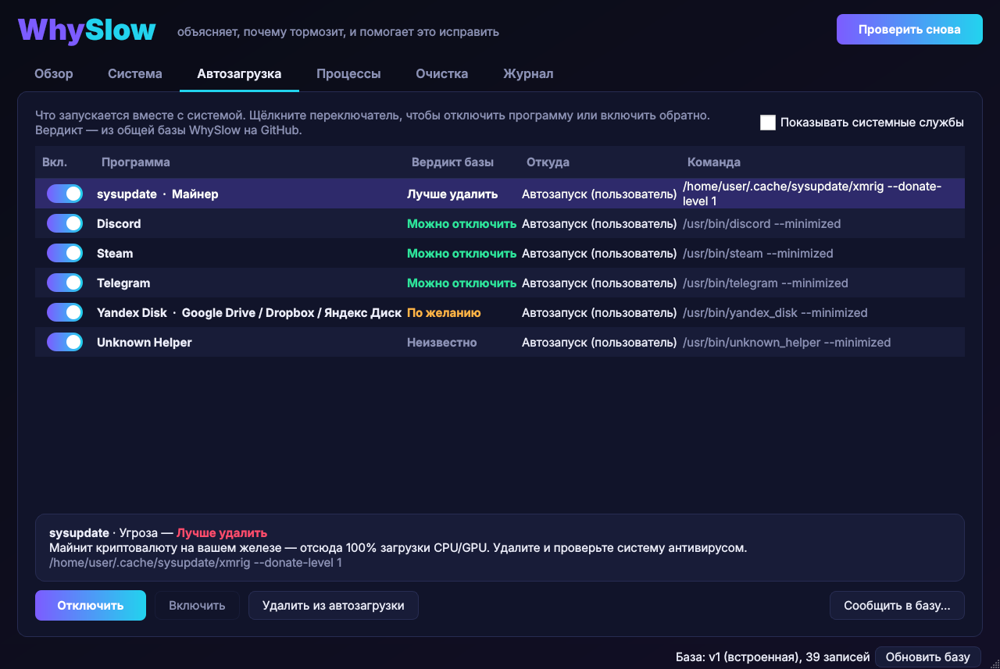

# WhySlow

**Объясняет, почему тормозит компьютер, и помогает это исправить** — человеческим языком, без «оптимизаторов» с рекламой.

Одна утилита в духе CPU-Z / GPU-Z: сведения о железе, нагрузка, автозагрузка, мусор, процессы.
Главное отличие — **общая база знаний на GitHub**: WhySlow сверяет каждую программу из автозагрузки
и каждый процесс с базой и говорит, можно ли это отключить, лучше не трогать или вообще удалить.


## Что умеет

| Вкладка | Что делает |
|---|---|
| **Обзор** | Живые плитки ЦП, памяти, диска и сети с графиками, кто сейчас грузит систему, и одна кнопка «Проверить» → список проблем с объяснением и кнопкой «Исправить» |
| **Система** | Процессор, ядра, частоты, память, видеокарта, диски, сеть, температуры — графики за последнюю минуту, как в Диспетчере задач |
| **Автозагрузка** | Всё, что стартует с системой, + вердикт базы. Отключить или включить переключателем прямо в списке, удалить |
| **Процессы** | Программы, сгруппированные по имени (браузер = десятки процессов), с вердиктом базы |
| **Очистка** | Временные файлы, кеши, корзина. Удаляет только ваши файлы старше суток |
| **Журнал** | Всё, что WhySlow поменял. Любое изменение автозагрузки и прокси откатывается одной кнопкой |

### «VPN сломал интернет»

Частая история: VPN-клиент закрылся аварийно и оставил включённым системный прокси на `127.0.0.1`,
который уже никто не слушает. Браузер и программы перестают выходить в интернет.
WhySlow находит такой «мёртвый» прокси и выключает его одной кнопкой (с возможностью отката).

### Безопасность

* Проверка **ничего не меняет**. Любое действие — только после подтверждения.
* Отключение автозагрузки сделано так же, как в системных инструментах:
  в Windows — флагом `StartupApproved` (как в Диспетчере задач), в Linux — копией `.desktop`
  с `Hidden=true` в `~/.config/autostart` (системные файлы не трогаются), в macOS — убирается из объектов входа,
  агент пользователя переносится в `~/Library/LaunchAgents/WhySlow-disabled`, а агенты и службы из `/Library`
  выключаются через `launchctl disable` (для служб macOS спросит пароль).
* «Удалить из автозагрузки» сохраняет резервную копию записи — её можно вернуть из «Журнала».
* Если база говорит «Не трогать», программа переспросит ещё раз.



## Запуск

Нужен Python 3.10+.

**Windows:** двойной клик по `run.bat`. Для изменения автозагрузки «для всех пользователей»
нажмите «Перезапустить от администратора» внизу окна.

**Linux / macOS:**

```bash
./run.sh
# или вручную
pip install -r requirements.txt
python3 -m whyslow
```

Текстовый режим без окна: `python3 -m whyslow --cli`

## Поддержка систем

| | Windows | Linux | macOS |
|---|---|---|---|
| Процессор, память, диски, процессы | ✅ | ✅ | ✅ |
| Видеокарта | ✅ (+NVIDIA: загрузка, t°) | ✅ lspci (+NVIDIA) | ✅ |
| Температуры | только NVIDIA | ✅ | — |
| Автозагрузка | реестр Run + папка «Автозагрузка» | XDG autostart + systemd | объекты входа, LaunchAgents, LaunchDaemons |
| Мёртвый прокси | ✅ + исправление | ✅ GNOME + исправление, переменные окружения | — |
| Очистка | Temp, кеш браузеров, дампы, обновления, корзина | кеш, миниатюры, /tmp, корзина | кеш, логи, корзина |

## База знаний

Файл: [`whyslow/data/known.json`](whyslow/data/known.json). При запуске программа скачивает свежую версию
отсюда, из ветки `main`, и кеширует её. Встроенная копия работает без интернета.

Запись выглядит так:

```json
{
  "id": "discord",
  "title": "Discord",
  "category": "Мессенджер",
  "verdict": "safe",
  "match": ["discord"],
  "note": "Мессенджер. Запустите вручную, когда понадобится."
}
```

* `verdict`: `safe` — можно отключить, `optional` — по желанию, `keep` — не трогать, `bad` — лучше удалить.
* `match`: регулярные выражения (без учёта регистра), ищутся в имени и команде запуска.
  Записи проверяются сверху вниз — побеждает первая совпавшая.
* После правки увеличьте `version` в начале файла, иначе программы не подхватят обновление.

Нашли неизвестную программу? Выберите её во вкладке «Автозагрузка» → **«Сообщить в базу…»** —
откроется готовый issue. Или сразу присылайте pull request в `known.json`.

## Устройство

```
whyslow/
  gui.py         интерфейс (PySide6)
  cli.py         текстовый режим
  checks.py      диагностика → список «находок»
  knowledge.py   база знаний: загрузка, обновление с GitHub, сопоставление
  startup.py     автозагрузка Windows / Linux / macOS
  processes.py   процессы, сгруппированные по программе
  junk.py        поиск и удаление мусора
  network.py     проверка системного прокси
  sysinfo.py     сведения о железе
  journal.py     журнал изменений для отката
  data/known.json
```

Данные программы (кеш базы, журнал, резервные копии): `%LOCALAPPDATA%\WhySlow` в Windows,
`~/.local/share/whyslow` в Linux и macOS.

## Планы

* Планировщик заданий Windows (задачи при входе в систему)
* Датчики температуры в Windows через LibreHardwareMonitor
* Сборка в один `.exe` (PyInstaller)
