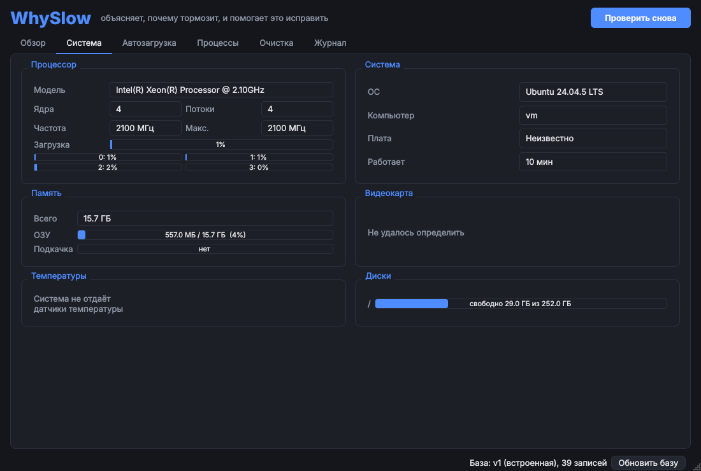
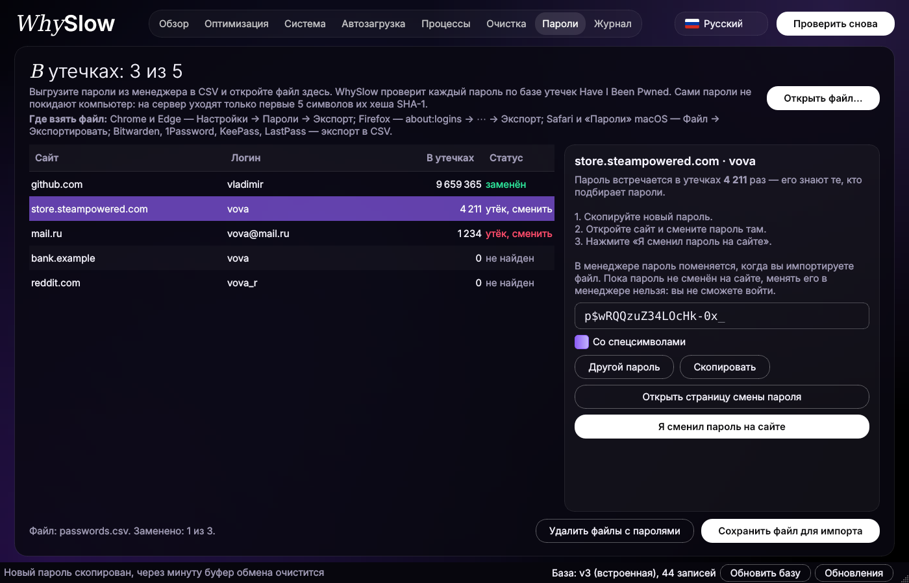
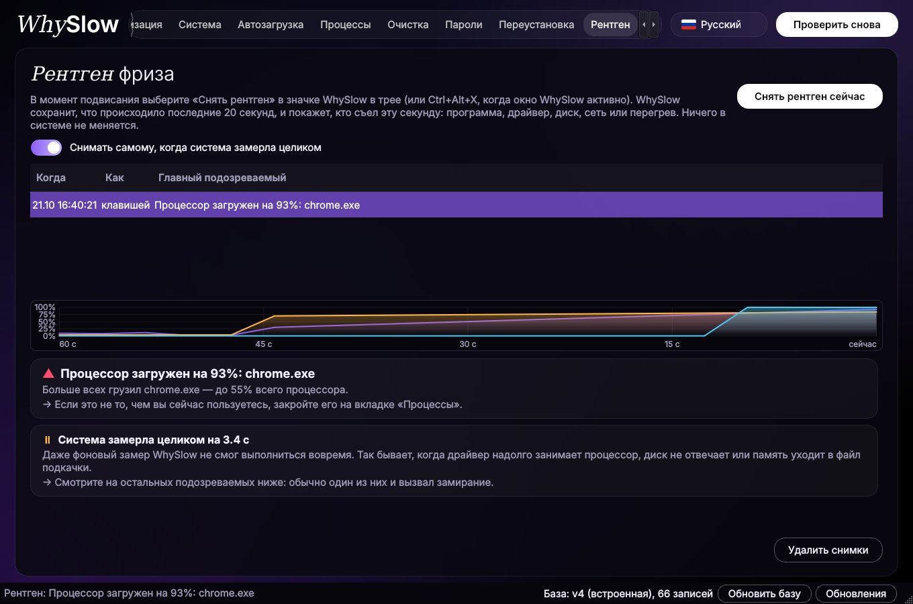
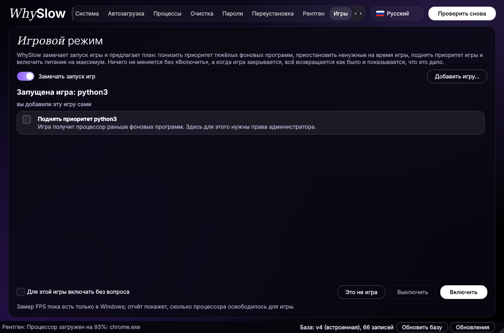
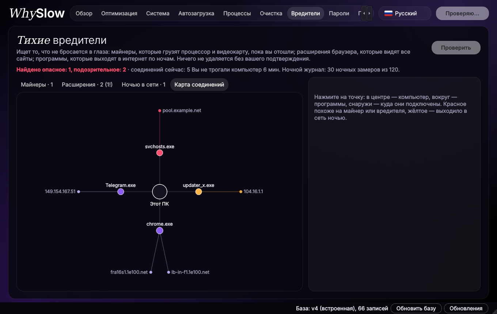
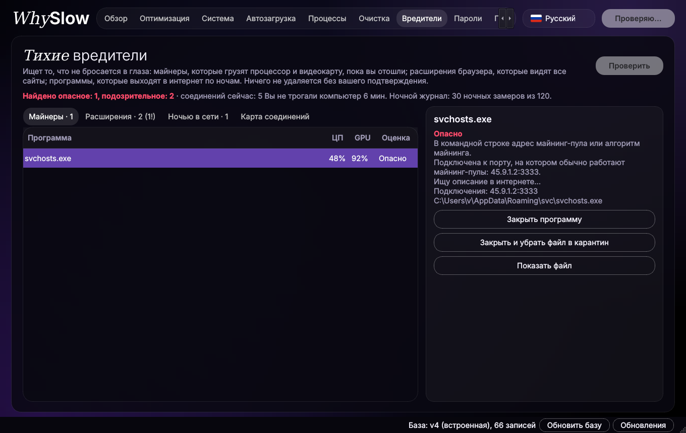

<div align="center">

# 🐢 WhySlow

**Объясняет, почему тормозит компьютер, и помогает это исправить** — человеческим языком, без «оптимизаторов» с рекламой.

[](https://github.com/moggiler0x/WhySlow/releases)

[](https://github.com/moggiler0x/WhySlow/actions/workflows/tests.yml)

🇷🇺 Русский · [🇬🇧 English](README.en.md) · [⬆ На главную](README.md)

**[⬇ Скачать](#скачать)** · [Что умеет](#что-умеет) · [Подписка](#подписка) · [Скриншоты](#скриншоты) · [Вопросы и ответы](#вопросы-и-ответы)

</div>

Одна утилита в духе CPU-Z / GPU-Z: сведения о железе, нагрузка, автозагрузка, мусор, процессы.
Главное отличие — **общая база знаний на GitHub**: WhySlow сверяет каждую программу из автозагрузки
и каждый процесс с базой и говорит, можно ли это отключить, лучше не трогать или вообще удалить.
Ничего не меняется без вашего подтверждения, а почти любое изменение откатывается одной кнопкой.


## Содержание

* [Скачать](#скачать)
* [Что умеет](#что-умеет)
  * [Бесплатно](#бесплатно)
  * [По подписке](#по-подписке)
* [Подписка](#подписка)
  * [Тарифы](#тарифы)
  * [Как купить и ввести ключ](#как-купить-и-ввести-ключ)
* [Скриншоты](#скриншоты)
* [Подробно о функциях](#подробно-о-функциях)
  * [Оптимизация в один клик](#оптимизация-в-один-клик)
  * [Какие проблемы находит](#какие-проблемы-находит)
  * [Системные данные macOS](#системные-данные-macos)
  * [Переустановка системы](#переустановка-системы)
  * [Пароли в утечках](#пароли-в-утечках)
  * [Прогноз: надолго ли хватит железа](#прогноз-надолго-ли-хватит-железа)
  * [Рентген фриза](#рентген-фриза-)
  * [Игровой режим](#игровой-режим-)
  * [Двойник ПК](#двойник-пк-)
  * [Риски в рублях](#риски-в-рублях-)
  * [Тихие вредители](#тихие-вредители-)
  * [Переезд на новый ПК](#переезд-на-новый-пк-)
  * [Сравнение с похожими ПК](#сравнение-с-похожими-пк-)
* [Безопасность и приватность](#безопасность-и-приватность)
* [Поддержка систем](#поддержка-систем)
* [Установка и запуск](#установка-и-запуск)
* [Обновление](#обновление)
* [Датчики температуры](#датчики-температуры)
* [База знаний](#база-знаний)
* [Вопросы и ответы](#вопросы-и-ответы)
* [Для владельца: подписка и выпуск версий](#для-владельца-подписка-и-выпуск-версий)
* [Устройство программы](#устройство-программы)

## Скачать

Готовое приложение: скачал, открыл, работает. Python и ничего другого ставить не нужно.

| Система | Файл |
|---|---|
| **Windows** 10 и 11 | [⬇ WhySlow-Windows.exe](https://github.com/moggiler0x/WhySlow/releases/latest/download/WhySlow-Windows.exe) |
| **macOS** на Apple Silicon (M1, M2, M3, M4…) | [⬇ WhySlow-macOS-AppleSilicon.dmg](https://github.com/moggiler0x/WhySlow/releases/latest/download/WhySlow-macOS-AppleSilicon.dmg) |
| **macOS** на Intel | [⬇ WhySlow-macOS-Intel.dmg](https://github.com/moggiler0x/WhySlow/releases/latest/download/WhySlow-macOS-Intel.dmg) |
| **Linux** x86_64 | [⬇ WhySlow-Linux-x86_64.AppImage](https://github.com/moggiler0x/WhySlow/releases/latest/download/WhySlow-Linux-x86_64.AppImage) |

Какой у вас Mac: меню  → **Об этом Mac**. Если там «Чип Apple M…» — берите Apple Silicon, если «Процессор Intel» — Intel.

Все версии лежат на странице [Releases](https://github.com/moggiler0x/WhySlow/releases). Приложения собирает
GitHub Actions прямо из кода этого репозитория ([`build.yml`](.github/workflows/build.yml)).

Как установить и разрешить первый запуск на своей системе — в разделе [Установка и запуск](#установка-и-запуск).

## Что умеет

### Бесплатно

| Вкладка | Что делает |
|---|---|
| **Обзор** | Живые плитки ЦП, памяти, диска и сети с графиками, кто сейчас грузит систему, и одна кнопка «Проверить» → список проблем с объяснением и кнопкой «Исправить» |
| **Оптимизация** | Одна кнопка «Оптимизировать»: WhySlow сам составляет план исправлений и выполняет отмеченное после «Применить» |
| **Система** | Процессор, каждое ядро отдельно, частоты, память, загрузка видеоядра, диски, сеть, температуры — графики за последнюю минуту |
| **Прогноз** | Сколько примерно лет железо ещё будет тянуть браузер, работу, игры и монтаж, что упрётся первым и что обновлять |
| **Автозагрузка** | Всё, что стартует с системой, + вердикт базы. Отключить, включить или удалить прямо в списке |
| **Процессы** | Программы, сгруппированные по имени (браузер = десятки процессов), с вердиктом базы |
| **Очистка** | Временные файлы, кеши, корзина и поиск больших файлов. Удаляет только ваши файлы старше суток |
| **Хранилище** (macOS) | Из чего состоят «Системные данные»: категории с размерами, пометки «важное» / «можно удалить», автоочистка |
| **Пароли** | Проверка паролей из менеджера по базе утечек и замена утёкших на новые случайные |
| **Переустановка** | Переустановить систему одной кнопкой: сначала копия выбранных папок на другой диск, потом штатное окно ОС |
| **История** | Когда и из-за чего тормозил компьютер: долгие пики нагрузки записываются в фоне, программа может жить в трее |
| **Журнал** | Всё, что WhySlow поменял, с откатом одной кнопкой |

### По подписке

Платные вкладки уже встроены в программу: без подписки на их месте замок с кнопками «Ввести ключ» и «Купить».

| Вкладка | Что делает |
|---|---|
| ⭐ **Рентген** | Нажмите Ctrl+Alt+X в момент подвисания — WhySlow разберёт последние 20 секунд и назовёт, кто съел эту секунду: программа, драйвер, диск, сеть или перегрев |
| ⭐ **Игры** | Игровой режим: замечает запуск игры, по согласию отдаёт ей процессор и питание, после игры возвращает всё как было и показывает, что это дало |
| ⭐ **Двойник** | Что дала бы новая видеокарта, память, SSD или процессор именно вашему компьютеру: кадры в играх, загрузка памяти, на сколько лет дольше хватит железа |
| ⭐ **Риски в ₽** | Что может сломаться (диски, аккумулятор, перегрев), насколько это вероятно и сколько стоит заняться этим сейчас против «потом» |
| ⭐ **Вредители** | Скрытые майнеры, расширения браузеров, которые видят все сайты, программы, которые выходят в сеть по ночам, и карта соединений |
| ⭐ **Переезд** | Переехать на новый ПК одной кнопкой: программы, их настройки и ваши файлы — без накопившегося мусора |
| ⭐ **Сравнение** | Анонимно сравнивает ваш ПК с компьютерами на таком же железе и называет программы, которых нет у быстрых похожих ПК |

## Подписка

Всё из раздела [«Бесплатно»](#бесплатно) бесплатно навсегда, без рекламы и ограничений. Подписка открывает
все платные вкладки сразу — отдельно ничего докупать не нужно.

### Тарифы

| Тариф | Цена | Устройства |
|---|---|---|
| **Соло** | **200 ₽ в месяц** | 1 компьютер |
| **Все устройства** | **800 ₽ в месяц** | до 10 ваших компьютеров: Windows, Mac и Linux вперемешку |

### Как купить и ввести ключ


1. Откройте WhySlow и нажмите **«★ Подписка»** внизу окна (или «Купить» на любой платной вкладке).
2. Выберите тариф и оплатите. Чтобы оформить подписку, напишите владельцу:
   [создайте запрос «Подписка»](https://github.com/moggiler0x/WhySlow/issues/new?title=%D0%9F%D0%BE%D0%B4%D0%BF%D0%B8%D1%81%D0%BA%D0%B0&body=%D0%A2%D0%B0%D1%80%D0%B8%D1%84%3A%20%D0%A1%D0%BE%D0%BB%D0%BE%20%2F%20%D0%92%D1%81%D0%B5%20%D1%83%D1%81%D1%82%D1%80%D0%BE%D0%B9%D1%81%D1%82%D0%B2%D0%B0)
   на GitHub — в ответ придут реквизиты и ключ.
   <!-- Когда заработает Telegram-бот, впишите сюда ссылку на него: оплата и ключ там приходят сразу. -->
3. Вставьте полученный ключ в поле **«Ключ»** и нажмите **«Активировать»**. Платные вкладки откроются сразу,
   перезапускать программу не нужно.

Ключ бывает двух видов:

* **Код активации** `WS-XXXX-XXXX-XXXX-XXXX` — просто введите его. Раз в сутки он проверяется на сервере,
  без интернета продолжает работать до недели. Чтобы перенести подписку на другой компьютер, нажмите
  «Отключить на этом компьютере» и введите тот же код на новом.
* **Ключ устройства** `WS1.…` — длинная строка, выпущенная под «Код этого компьютера» из окна «Подписка».
  Работает без интернета, но только на этом компьютере.

В текстовом режиме: `python3 -m whyslow --license` — состояние подписки, `python3 -m whyslow --license КЛЮЧ` — ввод ключа.

<br clear="right">

## Скриншоты

| | |
|:---:|:---:|
|  **Обзор** |  **Система** |
|  **Автозагрузка** |  **Пароли** |
|  ⭐ **Рентген фриза** |  ⭐ **Игровой режим** |
|  ⭐ **Вредители: карта соединений** |  ⭐ **Вредители: майнеры** |

<!-- Места под скриншоты, которые ещё не сняты (положите файлы в docs/ и раскомментируйте):
|  **Прогноз** |  ⭐ **Двойник** |
|  ⭐ **Риски в ₽** |  ⭐ **Переезд** |
|  ⭐ **Сравнение** |  **Хранилище macOS** |
-->

## Подробно о функциях

### Оптимизация в один клик

Кнопка «Оптимизировать» (на вкладке «Оптимизация» и в «Обзоре») проверяет компьютер и сама подбирает, что исправить:

* выключить зависший прокси, из-за которого пропал интернет;
* отключить в автозагрузке то, что база считает лишним или нежелательным;
* закрыть тяжёлые фоновые программы, которые база знает;
* очистить временные файлы, кеши и корзину.

План показывается списком с галочками. Безопасные пункты уже отмечены, сомнительные (службы, пункты с правами
администратора, корзина, закрытие программ) нужно отметить самому, а то, что база велит не трогать, не предлагается
вовсе. Ничего не меняется, пока вы не нажмёте «Применить» и не подтвердите. Отключение автозагрузки и прокси
откатывается во вкладке «Журнал»; очистка и закрытие программ необратимы, и в списке это подписано.
То, что программа сама не исправит (давно не было перезагрузки, перегрев), показывается ниже как совет.

### Какие проблемы находит

Каждая проверка отвечает на свой вопрос и, где можно, предлагает исправление:

* **Пропал интернет после отключения программы.** Некоторые программы при работе включают системный прокси
  и не выключают его, если закрылись с ошибкой. Прокси остаётся, но его никто не слушает,
  и браузер с другими программами не выходят в сеть. WhySlow находит это и выключает прокси одной кнопкой (с возможностью отката).
* **Процессор загружен.** Показывает, какая программа его грузит, и что о ней говорит база.
* **Не хватает оперативной памяти.** Топ процессов по памяти и заполненность файла подкачки.
* **Заканчивается место на диске.** Особенно на системном, плюс сколько можно освободить очисткой.
* **Перегрев.** Температуры комплектующих выше нормы.
* **Лишнее в автозагрузке.** Что можно отключить, что лучше удалить, а для того, чего нет в базе, — что о нём пишут в интернете.
* **Программы мешают друг другу.** Два антивируса сразу, несколько программ, которые перенаправляют трафик,
  сетевой адаптер или DNS, оставшиеся от закрытой программы, слишком много оверлеев поверх игр.
* **Диск медленный или неисправный.** Система на жёстком диске (HDD), диск сам сообщает о неисправности (SMART),
  диск занят почти всё время — с программами, которые больше всех читают и пишут.
* **Режим экономии энергии.** Включённая экономия заряда режет частоты процессора; плюс износ аккумулятора.
* **Компьютер давно не перезагружался.** Напоминание, что перезагрузка часто помогает сама по себе.

### Системные данные macOS

В настройках хранилища Mac «Системные данные» — одна серая полоса, которую не раскрыть. Вкладка **«Хранилище»**
раскладывает её по категориям и сортирует по размеру:

| Категория | Пометка |
|---|---|
| Кеши программ (`~/Library/Caches`), логи программ, кеши симуляторов, промежуточные сборки Xcode | можно удалить |
| Установщики «Установка macOS…», поддержка устройств Xcode, вложения Почты, Корзина | можно удалить |
| Резервные копии iPhone и iPad, архивы Xcode, симуляторы, Docker | важное, не трогать |
| Данные программ (Application Support, Containers, Group Containers) | смотря что, по каждой программе отдельно |
| Локальные снимки Time Machine, системные кеши и логи, загруженные обновления macOS, файл подкачки | удалится само |

У каждой категории есть пояснение, что это и чем грозит удаление, а внутри — список папок с размером и датой
(для копий iPhone видно имя устройства и дату копии). Отмеченное удаляется только после подтверждения:

* файлы **перемещаются в Корзину**, и каждое удаление записывается в «Журнал», откуда его можно вернуть на место;
* для важных категорий окно подтверждения перечисляет, что именно будет удалено, и просит проверить ещё раз;
* снимки Time Machine удаляются через `tmutil`, macOS спросит пароль администратора;
* Docker и симуляторы WhySlow не удаляет сам, а подсказывает, где это сделать правильно.

**Данные программ** разложены по отдельным программам: одна строка — одна программа, с размером и датой,
когда её последний раз открывали. WhySlow сверяет их с установленными приложениями и помечает:

* **остатки удалённой** — программы уже нет, а её данные лежат — можно удалить;
* **не открывали N мес.** — программу не запускали больше полугода (например, игра, в которую давно не играете) — можно
  удалить данные, а отдельной строкой и саму программу;
* **используется** и **программы того же разработчика** — удалять можно, но программа потеряет настройки и вход;
* **программа не найдена** — чья папка, понять не удалось, проверьте сами;
* **системное** — данные macOS, удалить нельзя.

Вместе с папками программы в Корзину уходят её настройки (`Preferences`), сохранённые окна и cookies.

**Автоочистка** — переключатель внизу вкладки, по умолчанию выключен. Если включить, WhySlow раз в день, неделю
или месяц (на выбор) удаляет файлы старше 7 дней из безопасных категорий: кеши и логи программ, промежуточные сборки
Xcode, кеши симуляторов. Работает, пока WhySlow запущен; каждый запуск виден во вкладке и в «Журнале».

**Полный доступ к диску.** Без него macOS не даёт прочитать копии iPhone, Почту, Корзину и часть данных программ.
WhySlow замечает это и показывает, как выдать доступ: Системные настройки → Конфиденциальность и безопасность →
Полный доступ к диску → включить WhySlow (или Терминал, если запускаете из исходников) и перезапустить программу.
Кнопка «Открыть настройки» сразу открывает нужный раздел.

### Переустановка системы

Вкладка **«Переустановка»** ставит систему заново одной кнопкой. Сама WhySlow ничего не стирает: она запускает
штатный механизм ОС, и его окно ещё раз спросит подтверждение.

1. Выберите режим: **«С сохранением файлов»** или **«Стереть всё»**.
2. Отметьте, что сохранить: Рабочий стол, Документы, Загрузки, Изображения, Музыку, Видео или любую свою папку
   («Добавить папку…»). Размер каждой папки считается сразу.
3. Выберите, куда сложить копию: другой внутренний диск, внешний диск или флешку. Диск с системой выбрать нельзя —
   при переустановке копия пропала бы вместе с ним. Места должно хватать.
4. Нажмите «Переустановить систему» и подтвердите, отметив «Я понимаю…». WhySlow скопирует папки и откроет окно ОС.

| Система | Что открывается |
|---|---|
| Windows | «Вернуть компьютер в исходное состояние». Выберите «Удалить всё» — останется чистая Windows, выбранные папки вернутся из копии. «Сохранить мои файлы» оставит вообще все личные файлы. Не включайте «Удалить файлы со всех дисков», если копия лежит на другом внутреннем диске |
| macOS, с сохранением | Установщик macOS той же версии (если его нет, WhySlow скачает его через `softwareupdate`, это несколько гигабайт). macOS ставится поверх: файлы, программы и настройки остаются, копия — на всякий случай |
| macOS, стереть всё | «Стереть контент и настройки» (macOS 12 и новее на Apple Silicon или с чипом T2). Если недоступно, WhySlow подскажет, как сделать это из режима восстановления |
| Linux | Только копия: общего способа переустановки нет, используйте установщик дистрибутива |

В папке копии лежат `restore.bat` (Windows) или `restore.command` (macOS) — они вернут файлы на место даже без
WhySlow. Или установите WhySlow заново и нажмите «Вернуть из копии…». Уже существующие файлы при возврате не
перезаписываются. Файлы, которые не удалось скопировать (нет доступа, заняты), перечислены в `whyslow-backup.json`,
и WhySlow спросит, продолжать ли переустановку без них. Программы и пароли браузеров в копию не попадают: программы
нужно будет установить заново, а для браузера включите синхронизацию.
А чтобы перенести и программы с настройками, воспользуйтесь [«Переездом»](#переезд-на-новый-пк-).

### Пароли в утечках

Вкладка «Пароли» находит пароли, которые уже есть в базах утечек, и помогает заменить их.

1. Выгрузите пароли из менеджера в CSV: Chrome и Edge (Настройки → Пароли → Экспорт), Firefox (about:logins → ⋯ → Экспорт),
   Safari и «Пароли» macOS (Файл → Экспортировать), Bitwarden, 1Password, KeePass, LastPass.
2. Откройте файл в WhySlow. Каждый пароль проверяется по базе [Have I Been Pwned](https://haveibeenpwned.com/Passwords).
   Пароли не покидают компьютер: на сервер уходят только первые 5 символов SHA-1 хеша, сравнение идёт у вас.
3. Для утёкшего пароля WhySlow предлагает новый случайный (20 символов, можно без спецсимволов) и открывает страницу
   смены пароля на сайте. Смените пароль там и нажмите «Я сменил пароль на сайте».
4. «Сохранить файл для импорта» — файл в формате того же менеджера, только с новыми паролями. Импортируйте его обратно
   в менеджер, и старые пароли заменятся.
5. «Удалить файлы с паролями» затирает и удаляет выгрузку и файл для импорта: в них пароли открытым текстом.

Пароль в менеджере меняется только после смены на сайте. Если поменять его только в менеджере, сайт его не примет,
и войти не получится.

### Прогноз: надолго ли хватит железа

Вкладка «Прогноз» определяет процессор, видеокарту, объём памяти и тип системного диска и сравнивает их с тем, что
сейчас требуют системы, браузеры, игры и рабочие программы, и с тем, как быстро эти требования растут.

* По каждой задаче (браузер и офис, работа, сетевые игры, новые требовательные игры, монтаж и 3D) — примерно сколько
  лет железо ещё её потянет и что упрётся первым.
* Выберите, чем вы чаще всего заняты, — WhySlow скажет, что и когда обновлять: SSD вместо жёсткого диска, память,
  видеокарту или уже весь компьютер. В ноутбуке и Mac не предлагает менять то, что не меняется.
* Отдельно — сколько ещё система будет получать обновления на этом железе (Windows 10, Mac на Intel и т. п.).

Это примерная оценка по типичным требованиям, а не гарантия. Требования лежат в
[`whyslow/data/hardware.json`](whyslow/data/hardware.json) и обновляются из интернета так же, как база знаний.

### Рентген фриза ⭐

WhySlow всё время держит в памяти последнюю минуту замеров: процессор и каждое ядро, память,
диск, сеть, видеокарту, температуры и самые тяжёлые процессы. В момент фриза нажмите **Ctrl+Alt+X** (в Windows
клавиша работает и поверх игры), или выберите «Снять рентген фриза» в значке WhySlow в трее. Программа сохранит
последние 20 секунд, на секунду заглянет в то, что нельзя мерить постоянно (время процессора на прерывания драйверов,
кто сейчас читает и пишет диск), и покажет подозреваемых по порядку: программа, одно перегруженное ядро, нехватка
памяти, диск, сеть, драйвер, перегрев или видеокарта. Если вся система замерла так, что даже фоновый замер не успел,
снимок делается сам. В системе при этом ничего не меняется.

### Игровой режим ⭐

WhySlow узнаёт игру по папкам Steam, Epic, GOG и других магазинов, по списку известных игр или
по тем, что вы добавили сами. На вкладке «Игры» появляется план с галочками:

* понизить приоритет тяжёлых фоновых программ (кроме того, что база велит не трогать, системных процессов и того,
  чем пользуются в игре: Discord, OBS, оверлеи). В macOS и Linux вернуть приоритет обратно может только
  администратор, поэтому без его прав там предлагается только пауза;
* приостановить ненужные на время игры (только если отметить);
* поднять приоритет самой игры;
* включить питание «Высокая производительность» (Windows) или профиль performance (Linux).

Ничего не меняется без кнопки «Включить». Можно отметить «Для этой игры включать без вопроса», и в следующий раз
план включится сам. Когда игра закрывается, приоритеты, пауза и питание возвращаются как были, даже если WhySlow
закрыли или он упал посреди игры. После игры видно, сколько процессора освободилось для игры, а если рядом лежит
бесплатный [PresentMon](https://github.com/GameTechDev/PresentMon/releases), то и сколько FPS было до и после.

### Двойник ПК ⭐

Прежде чем покупать деталь, посмотрите, что она даст именно вашему компьютеру. WhySlow берёт ваше
железо, сколько памяти занято прямо сейчас и кем, и сколько раз за месяц система упиралась в процессор или память
(вкладка «История»), и подставляет новую деталь:

* кадры в популярных играх до и после и что их держит — видеокарта, процессор или видеопамять. Если укажете,
  сколько кадров видите сами, расчёт подстроится под ваши настройки;
* «сейчас занято 14 из 16 ГБ, больше всех — Chrome; с 32 ГБ было бы 44%»;
* на сколько лет дольше железа хватит для вашей задачи, и что всё равно останется слабым местом;
* примерная цена и отметка «лучшее вложение» — больше всего пользы на рубль.

### Риски в рублях ⭐

Вкладка «Риски в ₽» проверяет диски (SMART), аккумулятор, перегрев и есть ли резервная копия (Time Machine, OneDrive,
«История файлов»). По каждому пункту — вероятность беды за год, когда её ждать, сколько стоит заняться этим сейчас
и во сколько обойдётся, если ждать: «копия — 0 ₽, восстановление данных после отказа — 15 000–50 000 ₽».

Цены, скорости деталей и вероятности отказов для «Двойника» и «Рисков» лежат в том же `hardware.json` и обновляются из интернета. Это оценка,
а не замер и не гарантия.

### Тихие вредители ⭐

Вкладка «Вредители» ищет то, что не бросается в глаза.

* **Скрытые майнеры.** Адрес майнинг-пула или алгоритм в командной строке, соединение на порт пула, нагрузка на
  процессор или видеокарту, пока за компьютером никого нет, файл в папке, откуда нормальные программы не запускаются.
  Загрузка видеокарты по процессам берётся из тех же счётчиков, что у Диспетчера задач, и из `nvidia-smi`.
* **Расширения браузеров** Chrome, Edge, Brave, Яндекс Браузера, Opera, Vivaldi, Firefox и Safari. Для каждого видно,
  видит ли оно все сайты и что ещё может (перехватывать запросы, читать cookie и историю, ставить свой прокси),
  поставлено ли оно из магазина, другой программой или принудительно через политику браузера.
* **Ночью в сети.** Пока WhySlow открыт или в трее, он раз в 5 минут записывает, какие программы держат соединения
  с интернетом. С 0 до 6 часов это засчитывается, только если за компьютером никого нет. Синхронизация и обновления
  помечаются как нормальные, неизвестные программы как подозрительные.
* **Карта соединений.** В центре компьютер, вокруг программы, снаружи адреса, куда они подключены. Красным отмечено
  то, что похоже на майнер, жёлтым то, что выходило в сеть ночью.

Каждую находку WhySlow объясняет по базе знаний. Закрыть программу, убрать её из автозагрузки, переместить файл
в карантин или снять принудительную установку расширения можно только после подтверждения. Карантин и снятую
политику можно вернуть на вкладке «Журнал». Расширение удаляется в самом браузере: WhySlow открывает его страницу.

### Переезд на новый ПК ⭐

Вкладка «Переезд» переносит всё нужное на новый компьютер одной кнопкой — без мусора, который
копился годами.

1. **На старом ПК** выберите «Это старый ПК — собрать пакет». WhySlow покажет установленные программы и то, чем каждая
   поставится заново (winget в Windows; Homebrew и App Store в macOS; Flatpak в Linux; расширения VS Code везде),
   найдёт настройки известных программ (VS Code, Git, закладки Chrome / Яндекс Браузера / Edge, OBS, Notepad++,
   Windows Terminal, PowerShell, zsh / bash, iTerm2, шрифты; SSH-ключи — только если отметить) и ваши папки.
2. Снимите лишние галочки и выберите флешку, внешний или сетевой диск. Кеши, временные файлы, `node_modules`,
   `Thumbs.db` и старые установщики из «Загрузок» в пакет не попадают. На старом компьютере ничего не меняется.
3. **На новом ПК** выберите «Это новый ПК — развернуть пакет» → «Открыть пакет…» и укажите папку `WhySlow-Move-…`.
   Отмеченные программы поставятся сами, настройки лягут по местам (уже существующие отложатся в резервную копию,
   вернуть их можно в «Журнале»), файлы вернутся в свои папки, не перезаписывая имеющиеся.

Пакет работает и без WhySlow: `install.bat` / `install.command` ставит программы, `files/restore.bat` /
`restore.command` возвращает файлы, а в `programs.txt` — список того, что скачать вручную. Между Windows и macOS
настройки переезжают там, где программа хранит одни и те же файлы (VS Code, Git, закладки, OBS).

### Сравнение с похожими ПК ⭐

По кнопке «Сравнить» WhySlow собирает анонимный снимок и **сначала показывает его целиком**: отправится он только после галочки согласия. В снимке: модель процессора и видеокарты, объём памяти, тип диска, версия ОС, время загрузки системы, нагрузка в простое, число процессов и программ в автозагрузке. Программы передаются только как записи открытой базы знаний, остальные лишь количеством. Имени, имени компьютера, путей, IP и ключа подписки рядом со снимком на сервере нет.

Сервер отвечает только сводкой (медианы и доли программ) и только если похожих ПК не меньше пяти. Кнопка «Удалить мои данные с сервера» стирает снимок и отзывает согласие.

## Безопасность и приватность

* Проверка **ничего не меняет**. Любое действие — только после подтверждения.
* Отключение автозагрузки сделано так же, как в системных инструментах:
  * **Windows** — флагом `StartupApproved` (как в Диспетчере задач), задания Планировщика выключаются
    как в самом Планировщике, службы переводятся в режим «Вручную» (Windows запустит их, если понадобится);
  * **Linux** — копией `.desktop` с `Hidden=true` в `~/.config/autostart` (системные файлы не трогаются);
  * **macOS** — убирается из объектов входа, агент пользователя переносится в `~/Library/LaunchAgents/WhySlow-disabled`,
    а агенты и службы из `/Library` выключаются через `launchctl disable` (для служб macOS спросит пароль).
* «Удалить из автозагрузки» сохраняет резервную копию записи — её можно вернуть из «Журнала».
* Если база говорит «Не трогать», программа переспросит ещё раз.
* Всё считается у вас на компьютере. В интернет WhySlow обращается только за свежей базой знаний, требованиями к железу
  и обновлениями (GitHub), за описанием неизвестных программ (Википедия), чтобы проверить пароль на утечку (уходят лишь
  первые 5 символов хеша), проверить ключ подписки и — только после вашей галочки — отправить анонимный снимок
  для «Сравнения».


## Поддержка систем

| | Windows | Linux | macOS |
|---|---|---|---|
| Процессор, память, диски, процессы | ✅ | ✅ | ✅ |
| Видеокарта | ✅ загрузка (+NVIDIA: t°) | ✅ lspci, загрузка NVIDIA и AMD | ✅ загрузка видеоядра |
| Температуры | через LibreHardwareMonitor (процессор, плата, диски) + NVIDIA | ✅ | ✅ Apple Silicon: процессор, накопитель, аккумулятор, без пароля |
| Автозагрузка | реестр Run и RunOnce, папка «Автозагрузка», Планировщик заданий, службы | XDG autostart + systemd | объекты входа, LaunchAgents, LaunchDaemons |
| Зависший прокси | ✅ + исправление | ✅ GNOME + исправление, переменные окружения | — |
| Очистка | Temp, кеш всех браузеров и профилей, кеш шейдеров, дампы, обновления, корзина | кеш, миниатюры, /tmp, корзина | кеш, логи, корзина |
| «Системные данные» по категориям, автоочистка | — | — | ✅ |

## Установка и запуск

### Windows

1. Дважды щёлкните `WhySlow-Windows.exe`. Можно положить его в любую папку, например на рабочий стол.
2. Приложение не подписано платным сертификатом, поэтому при первом запуске Windows может показать
   «Система Windows защитила ваш компьютер». Нажмите **Подробнее → Выполнить в любом случае**. Это один раз.
3. Чтобы менять автозагрузку «для всех пользователей» и видеть все температуры, нажмите
   **«Перезапустить от администратора»** внизу окна.

Про температуры процессора, платы и дисков — в разделе [Датчики температуры](#датчики-температуры).

### macOS

1. Откройте скачанный `.dmg` и перетащите **WhySlow** в папку **«Программы»** (Applications).
   Запускайте оттуда: прямо из образа диска приложение не сможет обновляться.
2. Приложение не подписано сертификатом разработчика Apple, поэтому при первом запуске macOS скажет,
   что не может проверить разработчика. Разрешить запуск нужно один раз:
   * **macOS 15 Sequoia и новее:** попробуйте открыть WhySlow, закройте предупреждение, затем
     **Системные настройки → Конфиденциальность и безопасность**, внизу у строки про WhySlow нажмите
     **«Всё равно открыть»** и подтвердите паролем.
   * **macOS 14 и старше:** щёлкните WhySlow в «Программах» правой кнопкой → **Открыть** → **Открыть**.
   * **Или одной командой в Терминале:**
     ```bash
     xattr -dr com.apple.quarantine /Applications/WhySlow.app
     ```

Температуры на Apple Silicon читаются без пароля и без дополнительных программ.

### Linux

```bash
chmod +x WhySlow-Linux-x86_64.AppImage
./WhySlow-Linux-x86_64.AppImage
```

Или в файловом менеджере: «Свойства → Разрешить запуск как программы», потом двойной щелчок.
Если пишет про FUSE, поставьте `libfuse2` (в Ubuntu 24.04 — `libfuse2t64`) или запустите
с ключом `--appimage-extract-and-run`. Температуры берутся из системы сами.

### Из исходников

Для тех, кто хочет править код. Нужен **Python 3.10 или новее**, остальные библиотеки скрипты запуска поставят сами.

```bash
git clone https://github.com/moggiler0x/WhySlow.git   # или Code → Download ZIP
cd WhySlow
./run.sh        # macOS и Linux
run.bat         # Windows (Python с python.org, отметьте Add python.exe to PATH)
```

* macOS: если пишет «Permission denied», выполните один раз `chmod +x run.sh`. Если программа не может
  проверить сертификат GitHub (бывает с Python с python.org), выполните `pip3 install certifi`
  или запустите `Install Certificates.command` из папки Python в «Программах».
* Собрать приложение у себя: `pip install -r requirements.txt pyinstaller pillow`, затем
  `python packaging/build.py` — готовый файл появится в `dist/`.

### Текстовый режим

Без окна, прямо в терминале (из исходников; на macOS и Linux так же работает и приложение):

```bash
python3 -m whyslow --cli       # проверка, отчёт и план оптимизации (ничего не меняет)
python3 -m whyslow --optimize  # то же, затем выполнить отмеченные пункты (спросит подтверждение)
python3 -m whyslow --passwords выгрузка.csv   # какие пароли из менеджера есть в утечках (ничего не меняет)
python3 -m whyslow --forecast  # надолго ли хватит железа и что обновлять первым
python3 -m whyslow --storage   # macOS: из чего состоят «Системные данные» и что можно удалить
python3 -m whyslow --twin      # ⭐ что дал бы апгрейд этому компьютеру
python3 -m whyslow --risks     # ⭐ что может сломаться и сколько это стоит
python3 -m whyslow --pests     # ⭐ скрытые майнеры, опасные расширения, ночной выход в сеть
python3 -m whyslow --license [КЛЮЧ]  # состояние подписки или ввод ключа
python3 -m whyslow --version   # версия
python3 -m whyslow --update    # обновление (спросит подтверждение)
python3 -m whyslow --cli --lang en   # язык на этот запуск: ru или en
```

Команды с ⭐ работают по подписке; все, кроме `--optimize` и `--update`, ничего в системе не меняют.

### Язык

Программа говорит по-русски и по-английски. По умолчанию — на языке системы; переключить можно списком
вверху окна (программа перезапустится на выбранном языке и запомнит его).

## Обновление

WhySlow сам находит новые версии в этом репозитории. Кнопка **«Обновления»** внизу окна
показывает, что нового, и ставит версию после вашего подтверждения. Когда выходит новая версия,
кнопка подсвечивается: «Обновить до …».

* **Проверять при запуске** включено по умолчанию: программа только сообщает о новой версии.
* **Устанавливать автоматически** выключено по умолчанию. Если включить, новая версия ставится
  сама при запуске, останется нажать «Перезапустить».
* Если новая версия не запустилась, старая возвращается сама. Удачное обновление
  тоже можно откатить во вкладке «Журнал».

Как ставится обновление, зависит от того, как вы получили программу:

* **готовое приложение** — из релиза скачивается файл для вашей системы. WhySlow сверяет контрольную
  сумму, проверяет, что новая версия запускается, и только потом заменяет ею текущую. Старая
  сохраняется в папку данных (`updates/`). На Mac приложение должно лежать в «Программах».
* **git clone** — через git, на тег новой версии. Если вы правили файлы программы, обновление
  откажется, чтобы не затереть ваши правки. `git pull` по-прежнему работает.
* **архив ZIP с исходниками** — скачивается архив новой версии, текущие файлы сохраняются в папку данных
  (`updates/`) и заменяются.

## Датчики температуры

* **macOS (Apple Silicon)** и **Linux** — температуры читаются сами, ничего ставить не нужно.
* **Видеокарты NVIDIA** — температура берётся через драйвер на всех системах.
* **Windows** сама не отдаёт температуры процессора, платы и дисков. WhySlow берёт их у
  [LibreHardwareMonitor](https://github.com/LibreHardwareMonitor/LibreHardwareMonitor/releases), двумя способами:
  1. **Проще всего:** нажмите «Скачать и запустить LibreHardwareMonitor» в блоке «Температуры»
     на вкладке «Система». WhySlow спросит подтверждение, скачает официальный релиз с GitHub,
     сверит контрольную сумму, распакует его в `%LOCALAPPDATA%\WhySlow\lhm` и запустит
     с запросом прав администратора. Не закрывайте LHM (он сворачивается в трей): WhySlow
     читает датчики через WMI. После перезагрузки там же будет кнопка «Запустить».
     Скачанное удаляется откатом в «Журнале».
  2. **Без открытого окна LHM:** положите `LibreHardwareMonitorLib.dll` и `HidSharp.dll` из архива LHM
     в `%LOCALAPPDATA%\WhySlow\lhm` (или укажите папку в переменной `WHYSLOW_LHM_DIR`),
     поставьте `pip install pythonnet` и запускайте WhySlow от администратора.
     Если LHM установлен в `Program Files\LibreHardwareMonitor`, DLL найдётся там сама.

Если датчиков нет, вкладка «Система» и проверка объяснят, чего не хватает.

## База знаний

Файл: [`whyslow/data/known.json`](whyslow/data/known.json). При запуске программа скачивает свежую версию
отсюда, из ветки `main`, и кеширует её. Встроенная копия работает без интернета.

### Как устроена запись

```json
{
  "id": "discord",
  "title": "Discord",
  "title_en": "Discord",
  "category": "Мессенджер",
  "category_en": "Messenger",
  "verdict": "safe",
  "match": ["discord"],
  "note": "Мессенджер. Запустите вручную, когда понадобится.",
  "note_en": "Messenger. Start it manually when you need it."
}
```

* `title`, `category`, `note` — по-русски; `title_en`, `category_en`, `note_en` — те же поля по-английски.
  Если английского поля нет, программа покажет русский текст.

* `verdict`: `safe` — можно отключить, `optional` — по желанию, `keep` — не трогать, `bad` — лучше удалить.
* `match`: регулярные выражения (без учёта регистра), ищутся в имени и команде запуска.
  У служб Windows в конец строки добавляется короткое имя службы, поэтому её удобно ловить как `\bwsearch$` (в JSON — `\\bwsearch$`).
  Записи проверяются сверху вниз — побеждает первая совпавшая.
* После правки увеличьте `version` в начале файла, иначе программы не подхватят обновление.

### Если программы нет в базе

WhySlow сам выясняет, что это, чтобы не искать вручную:

1. читает сведения из самого файла: описание, название продукта и издателя
   (в Windows — свойства `.exe`, в macOS — `Info.plist` приложения);
2. ищет статью в Википедии, сначала в русской, потом в английской. Ключи и регистрация не нужны.

Найденное показывается в подробностях на вкладках «Автозагрузка» и «Процессы» с пометкой
«из интернета, не проверено» и ссылкой на источник. Вердикт «можно отключить» по таким данным
не ставится: решать, что отключать, по-прежнему помогает только сама база.
Ответы кешируются в `online.json` рядом с кешем базы (найденное — на месяц, промахи — на три дня).

### Как предложить запись

* В программе выберите запись на вкладке «Автозагрузка» или «Процессы» и нажмите **«Предложить в базу…»** —
  откроется готовый issue, куда уже подставлено найденное описание.
* Или пришлите pull request с правкой [`known.json`](whyslow/data/known.json).

### Требования программ к железу

Для вкладки «Прогноз» — файл [`whyslow/data/hardware.json`](whyslow/data/hardware.json). Программа скачивает его
отсюда при открытии вкладки или по кнопке «Обновить требования из интернета». Когда выходят новые игры и процессоры
или меняются требования, достаточно поправить файл и поднять `version`:

* `cpu`, `gpu` — правила распознавания моделей: регулярное выражение, год выхода и `tier` — поправка за класс в годах
  (топовая видеокарта держится как средняя на несколько лет новее). Год и класс можно брать из части названия:
  `{"group": "gen", "map": {"12": 2021}}`.
* `workloads` — задачи: сколько лет после года выхода (с поправкой) железо их тянет (`cpu_years`, `gpu_years`),
  сколько памяти нужно сейчас (`ram_gb`, `vram_gb`) и за сколько лет требование удваивается (`ram_double`).
* `os` — сроки поддержки систем, `suggest` — примеры актуальных моделей для советов, `market` — заметки о ценах.
* `perf` — скорость видеокарт и процессоров относительно RTX 3060 и Ryzen 5 3600, `games` — кадры в играх на этом
  эталоне, `upgrades` — детали для «Двойника» с ценами (`rub`, `usd`), `health` — вероятности отказов и цены ремонта.

## Вопросы и ответы

**WhySlow что-нибудь сломает?**
Проверка ничего не меняет. Любое действие — только после подтверждения, а то, что база велит не трогать,
даже не предлагается. Отключение автозагрузки, прокси, карантин, игровой режим и перенесённые настройки
откатываются во вкладке «Журнал». Необратимое (очистка, закрытие программ) в списке так и подписано.

**Это антивирус?**
Нет. WhySlow не заменяет антивирус: он показывает, что грузит систему и что запускается вместе с ней.
«Тихие вредители» ищут то, что антивирусы часто пропускают — скрытые майнеры, расширения браузеров с доступом
ко всем сайтам, ночную сетевую активность, — но решение, что удалять, всегда за вами.

**Почему Windows или macOS пишет, что приложение от неизвестного разработчика?**
Приложение не подписано платным сертификатом. Его собирает GitHub Actions прямо из кода этого репозитория.
Как разрешить запуск один раз — в разделе [Установка и запуск](#установка-и-запуск).

**Зачем права администратора?**
Без них всё работает. Права нужны, только чтобы менять автозагрузку «для всех пользователей», видеть
температуры в Windows и (в игровом режиме) поднимать приоритет обратно в macOS и Linux.

**Почему не видно температуры процессора в Windows?**
Windows сама их не отдаёт. Нажмите «Скачать и запустить LibreHardwareMonitor» на вкладке «Система» —
подробности в разделе [Датчики температуры](#датчики-температуры).

**Что делать, если программы нет в базе?**
WhySlow сам поищет её описание в свойствах файла и в Википедии, а кнопкой «Предложить в базу…» можно отправить
запись, чтобы она появилась у всех.

**Подписка продлевается сама?**
Нет. Подписка действует оплаченный срок; когда он заканчивается, платные вкладки снова закрываются замком,
а все ваши данные и бесплатные функции остаются. Продлить — оплатить ещё месяц тем же способом.

**Можно ли перенести подписку на новый компьютер?**
Да. Код активации отключается кнопкой «Отключить на этом компьютере» и вводится на новом. На тарифе
«Все устройства» его можно ввести сразу на десяти компьютерах.

**Платные функции работают без интернета?**
Да, кроме «Сравнения» (оно считается на сервере). Код активации проверяется раз в сутки и без сети работает до недели,
ключ устройства `WS1.…` не требует интернета вовсе.

**Нашёл ошибку или хочу предложить идею.**
Создайте [issue](https://github.com/moggiler0x/WhySlow/issues) — лучше со снимком экрана и версией из кнопки «Обновления».

## Для владельца: подписка и выпуск версий

Этот раздел нужен только владельцу репозитория. Полная пошаговая инструкция — в [server/README.md](server/README.md).

1. **Ключи, один раз.** `python owner/keys.py init` — создаёт ключ подписи и секрет шифрования в `~/.whyslow-owner/`
   и вписывает открытый ключ в `whyslow/license.py`. Закоммитьте это изменение. Сделайте резервную копию папки
   `~/.whyslow-owner` и никому её не показывайте.
2. **Секрет для сборки.** `python owner/keys.py seal-secret` → на GitHub: **Settings → Secrets and variables → Actions →
   New repository secret**, имя `WHYSLOW_SEAL_SEED`, значение — выведенная строка. Без него релиз соберётся,
   но код платных функций попадёт в приложение незашифрованным.
3. **Продажа без сервера** (можно начать сразу): покупатель присылает «Код этого компьютера», вы выпускаете ключ
   командой `python owner/keys.py issue solo 1 КОД` и отправляете ему строку `WS1.…`.
4. **Сервер активации и Telegram-бот** (по желанию, бесплатный тариф Cloudflare): коды `WS-…`, перенос между
   компьютерами, отзыв, продление и оплата прямо в боте. Разворачивается по разделам 3–4 [server/README.md](server/README.md);
   адрес сервера впишите в `SERVER_URL` в `whyslow/license.py`.
5. **Сравнение с похожими ПК** работает через тот же сервер: один раз создайте базу по [server/COMPARE.md](server/COMPARE.md)
   (три команды).
6. **Ссылка «Купить».** Кнопки «Купить» в программе ведут на `PREMIUM_URL` в `whyslow/license.py` — сейчас это раздел
   [«Подписка»](#подписка) этой страницы. Когда появится бот, поменяйте ссылку в разделе «Как купить» или сам `PREMIUM_URL`.

### Выпуск новой версии

Одной кнопкой: на GitHub откройте **Actions → Release → Run workflow** и нажмите **Run workflow**.
Поле версии можно оставить пустым — возьмётся следующая (0.2.5 → 0.2.6), или впишите свою, например `0.3.0`.
Workflow ([`release.yml`](.github/workflows/release.yml)) сам запишет версию в
[`whyslow/__init__.py`](whyslow/__init__.py), закоммитит её в `main`, поставит тег, соберёт приложения
для Windows, macOS и Linux, прикрепит их к релизу и опубликует его со списком изменений. Пока идёт сборка,
релиз остаётся черновиком. Текст релиза программа покажет в окне «Обновления», его можно дописать на GitHub.

Старые способы тоже работают: **Releases → Draft a new release** на сайте или `git tag v0.3.0 && git push origin v0.3.0`.
Если версию в коде при этом не подняли, workflow сам допишет её и передвинет тег на этот коммит,
а приложения прикрепит к релизу, как только соберёт.

Копии из исходников видят новую версию сразу после тега, готовые приложения — когда к релизу прикреплена
сборка для их системы.

## Устройство программы

```
whyslow/
  gui.py           интерфейс (PySide6)
  cli.py           текстовый режим
  checks.py        диагностика → список «находок»
  optimize.py      план оптимизации из результатов проверки и его выполнение
  knowledge.py     база знаний: загрузка, обновление с GitHub, сопоставление
  online.py        описание неизвестных программ: сведения о файле и Википедия
  startup.py       автозагрузка Windows / Linux / macOS
  processes.py     процессы, сгруппированные по программе
  junk.py          поиск и удаление мусора
  bigfiles.py      поиск больших файлов и удаление в Корзину
  macstorage.py    «Системные данные» macOS: категории, удаление в Корзину, автоочистка
  macapps.py       данные программ на Mac: установлена ли программа, давно ли открывали
  network.py       проверка системного прокси
  conflicts.py     программы, которые мешают друг другу: антивирусы, перенаправление трафика, DNS, оверлеи
  diskhealth.py    физические диски: SSD или HDD, SMART, загрузка и кто её создаёт
  power.py         режим экономии энергии и износ аккумулятора
  sysinfo.py       сведения о железе, загрузка видеоядра
  forecast.py      прогноз: надолго ли хватит железа и что обновлять
  reinstall.py     копия выбранных папок и запуск штатной переустановки ОС
  passwords.py     проверка паролей по базе утечек, новые пароли, файл для импорта
  watch.py         запись тормозов в фоне, запуск вместе с системой
  journal.py       журнал изменений для отката
  restore.py       откат действий платных функций (карантин, политики браузера) — работает и без подписки
  gamerestore.py   откат игрового режима после сбоя — работает и без подписки
  lhm.py           температуры в Windows через LibreHardwareMonitor
  macsensors.py    температуры и загрузка видеоядра на Mac без прав администратора
  updater.py       обновление программы из GitHub
  license.py       подписка: проверка ключей (Ed25519), код устройства, активация на сервере
  license_ui.py    окно «Подписка» и замок на платных вкладках
  ed25519.py       проверка подписи ключей
  seal.py          шифрование кода платных функций
  settings.py      настройки
  i18n.py          язык интерфейса: русский и английский
  premium/         платные функции; в релизе каждая зашифрована (<функция>.wsl)
    xray.py          рентген фриза
    gamemode.py      игровой режим
    twin.py          двойник ПК
    health_money.py  риски в рублях
    pests.py         тихие вредители
    migrate.py       переезд на новый ПК
    compare.py       сравнение с похожими ПК
  data/known.json      база знаний
  data/hardware.json   требования программ к железу, цены деталей, вероятности отказов
tests/             тесты: python -m pytest tests
owner/             выпуск ключей и шифрование модулей (только для владельца)
server/            сервер подписки, Telegram-бот и сравнение (Cloudflare Workers)
packaging/         сборка готового приложения (PyInstaller) и иконка
```

Данные программы (кеш базы, журнал, настройки, резервные копии, прошлые версии): `%LOCALAPPDATA%\WhySlow` в Windows,
`~/.local/share/whyslow` в Linux и macOS.
